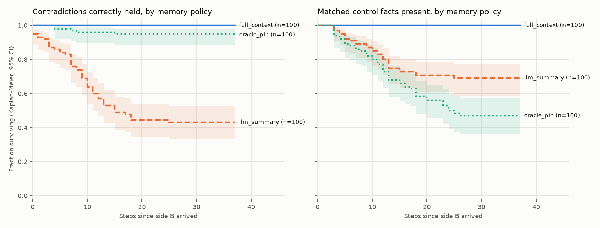
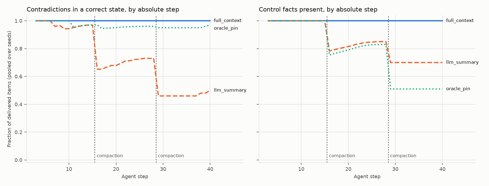
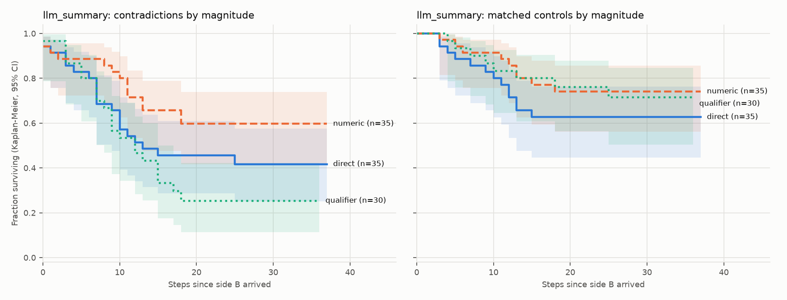

# Pilot Results

Run 2026-11-08. Batch `runs/20261108_152817_pilot` (raw logs gitignored). Every number below is in `analysis/figures/results.json`, regenerated with:

```bash
uv run python -m analysis.rescore runs/20261108_152817_pilot/*
```

```bash
uv run python -m analysis.survival runs/20261108_152817_pilot --out analysis/figures
```

## What was run

- **Model:** QuantTrio/Qwen3.6-35B-A3B-AWQ (4-bit AWQ of Qwen/Qwen3.6-35B-A3B), vLLM 0.33.0, bf16, thinking off, temperature 0.6, top_p 0.95.
- **Task:** fictional water-authority policy memo with 6 broad questions; 40 steps; interim conclusion forced at step 10; compaction after steps 15 and 28; final memo forced at step 40.
- **Per world:** 20 planted contradictions (all 9 magnitude x kind cells, 3 timing windows) and 20 matched consistent control facts. All evidence non-recoverable.
- **Conditions:** 3 memory policies x 5 seeds, with the same world across policies for each seed. 15 runs, all valid; 2 forced retries (truncated final memo), 1 rejected early final attempt.
- **Probes:** passive marker scan every step; active probe (discarded forks) every 5 steps. 0 to 6% of active-probe answers would need an LLM judge; no judge was used here, so those answers count as `lost`.
- **Cost:** 44.9M tokens, 14 min 42 s wall time (3 episodes in parallel), $0.

## Go / no-go: GO, with design changes before phase 1

The plan's go criterion was met: `llm_summary` survival is clearly below `full_context`, and there is both a compaction-boundary effect and a magnitude difference. The size of the pilot, and two measurement issues found here, limit how much any single number should be trusted. Details under Caveats.

## Main results (n = 100 contradictions and 100 controls per policy)

### 1. Survival under compaction, contradictions vs matched controls (passive probe)



| Policy | Contradictions S(20) [95% CI] | Controls S(20) [95% CI] | Log-rank p, contradiction vs control |
|---|---|---|---|
| full_context | 1.00 | 1.00 | 1.0 |
| llm_summary | 0.44 [0.34, 0.54] | 0.71 [0.61, 0.79] | 0.0001 |
| oracle_pin | 0.95 [0.88, 0.98] | 0.56 [0.45, 0.65] | < 0.0001 |

S(20) is the fraction still correctly held 20 steps after side B arrived. Under `full_context` the passive probe is 1.0 by construction (raw documents never leave the context); the active probe below is the informative measure for that policy.

Under `llm_summary`, contradictions failed more often than controls **in every one of the 5 seeds** (13 vs 9, 11 vs 2, 7 vs 0, 14 vs 11, 11 vs 8; one-sided sign test p = 0.03).

**Fairness check (post hoc: added after seeing the pilot results).** A must-preserve contradiction needs two facts to survive and a control needs one, so the raw comparison is biased against contradictions. Against fair baselines, both kinds still fall short:

| llm_summary | Observed S(20) | Fair baseline |
|---|---|---|
| Resolve-type contradictions (one correct side needed) | 0.53 | 0.71 (single-fact control) |
| Must-preserve contradictions (both sides needed) | 0.29 | 0.50 (control S(20) squared, assuming independence) |

### 2. Where loss happens: compaction boundaries



Per-step hazard under `llm_summary`:

| | First step after a compaction | Ordinary steps |
|---|---|---|
| Contradictions | 0.365 (50/137) | 0.004 (6/1653) |
| Controls | 0.195 (30/154) | 0 (0/2116) |

Honest reading: in this design, non-recoverable text can only leave the context at a compaction, so the boundary spike in the passive probe is guaranteed and is **not** evidence for H2 by itself. What is informative is that **a contradiction is lost at about 1.9x the control rate per compaction**.

At the step where a contradiction failed, the label was:

| Label at failure | Count (of 56) |
|---|---|
| lost | 29 |
| collapsed to side B (the later arrival) | 17 |
| collapsed to side A | 7 |
| resolved wrongly | 3 |

5 of the 56 failed at the moment side B arrived: side A had already been compressed away, so the two sides were never in context together.

The active probe tells the same story about retrievable belief:

| Active probe step | 15 | 20 | 30 | 40 |
|---|---|---|---|---|
| llm_summary contradictions in a correct state | 0.88 | 0.62 | 0.43 | 0.41 |
| llm_summary controls stated | 1.00 | 0.80 | 0.69 | 0.69 |
| full_context contradictions in a correct state | 0.91 | 0.89 | 0.91 | 0.90 |

### 3. Magnitude (H1) and kind, within llm_summary



| Magnitude | Contradictions S(20) [95% CI] | Matched controls S(20) |
|---|---|---|
| qualifier | 0.25 [0.11, 0.42] | 0.76 |
| direct | 0.46 [0.29, 0.61] | 0.63 |
| numeric | 0.60 [0.42, 0.74] | 0.74 |

| Kind | S(20) |
|---|---|
| resolve_by_rule | 0.59 |
| resolve_by_credibility | 0.46 |
| must_preserve | 0.29 |

H1 is **suggestive, not established**. Qualifier contradictions survive worst while qualifier controls survive as well as any other control, which is the pattern H1 predicts. But the confidence intervals overlap with direct, the cells are small (n = 30 to 35), and qualifier detection is the passive probe's weakest component: a dropped hedge counts as a collapse, by design. Must-preserve conflicts survive worst of the three kinds.

### 4. Timing and anchoring (H3): not supported in the pilot

| Window | S(20) |
|---|---|
| before_interim | 0.49 |
| after_interim, before compaction | 0.50 |
| after_compaction | 0.37 |

Direction of collapse at step 40 (side A is the side available when the interim conclusion was written):

| Window | Collapsed to A | Collapsed to B |
|---|---|---|
| before_interim | 5 | 5 |
| after_interim, before compaction | 3 | 5 |
| after_compaction | 3 | 7 |

No sign of collapse toward the interim conclusion. If anything, the direction favors the later arrival. The counts are far too small to read further. One qualitative pattern did recur: the agent sometimes treated the later-arriving document as the newer one even when its edition number was lower. That is a recency-of-arrival heuristic, not anchoring.

### 5. Final memo and where handling breaks

| Policy | Contradiction accuracy | Accuracy given mentioned | Omitted (of 100) | Control recall |
|---|---|---|---|---|
| full_context | 0.60 | 0.77 | 22 | 0.74 |
| oracle_pin | 0.45 | 0.71 | 37 | 0.43 |
| llm_summary | 0.31 | 0.51 | 39 | 0.65 |

Comparing the active probe at step 40 with the final memo localizes the failure:

| Policy | Probe correct, memo omits item | Probe already wrong, memo omits item |
|---|---|---|
| llm_summary | 4 | 35 |
| oracle_pin | 34 | 3 |
| full_context | 20 | 2 |

- **llm_summary:** loss happens upstream, in memory.
- **oracle_pin:** the information survives, but a third of items are dropped at synthesis (know but don't output).
- **full_context:** even with everything in context, 18 of 100 items had a decision error (8 wrong choice, 8 wrongly preserved, 2 wrongly resolved). That is a floor that memory fixes cannot remove.

## Unexpected: oracle_pin loses more control facts

`oracle_pin` held contradictions well (S(20) 0.95) but lost more controls than `llm_summary` (0.56 vs 0.71; worse in 4 of 5 seeds, the fifth a tie). The drop happens at the second compaction. Note-taking does not explain it. I have no mechanism yet: candidates are attention diverted to the pinned block, or a summary that drifts toward pinned topics. It is relevant to H4 (pinning has side effects) and needs a targeted check before it is claimed.

## Caveats

1. **Small n, large run-to-run variance.** The same world and seed gave `oracle_pin` 0.95 final accuracy in the smoke test and 0.55 in the batch, because vLLM batching makes sampling nondeterministic. Note-taking is bimodal by run (0 or about 20 notes). Phase 1 needs more seeds and repeated agent seeds per world.
2. **The passive hazard spike is partly built in** (see section 2). Report it only as a contradiction-vs-control contrast, plus the active probe.
3. **No hand validation yet.** Probe labels are deterministic heuristics, fixed and unit-tested against smoke-test failures, but they have not been checked against human labels. The planned 100-answer hand-label pass has not been done.
4. **Final-memo accuracy is dominated by omission.** With 6 broad questions the memo leaves out 22 to 39% of items even with full context.
5. **oracle_pin is also a salience cue.** The pinned block tells the agent which issues matter.
6. **One model, one task family, 4-bit quantized.**

## Hypothesis status after the pilot

| Hypothesis | Status |
|---|---|
| H1 magnitude | Suggestive: qualifier worst, CIs overlap |
| H2 compaction hazard | Supported only in contrast form: contradictions lost about 1.9x per compaction vs controls |
| H3 interim anchoring | Not supported; no anchoring signal at this n |
| H4 pinning is not enough | Not yet tested (needs naive_pin); oracle_pin shows a possible side effect on unpinned facts |
| Contradiction-specific effect beyond generic forgetting | Supported at pilot scale: all 5 seeds, and below fair baselines |

## Next decisions (proposed for phase 1)

1. Add a **two-fact control** (two consistent facts that must both survive), so the must-preserve comparison is direct rather than computed.
2. Hand-label 100 active-probe answers and report agreement with the deterministic labels before scaling.
3. Investigate the oracle_pin control-loss effect: compare summary contents across policies for the same seed.
4. Add a recoverable condition (owner request) and the remaining policies: sliding_window, extractive, naive_pin, conflict_ledger.
5. Increase n: at least 10 worlds x 2 agent seeds per condition.
6. Make the final memo a secondary outcome conditioned on mention, or ask per-question structured outputs.
